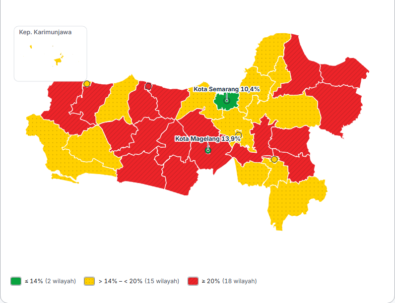
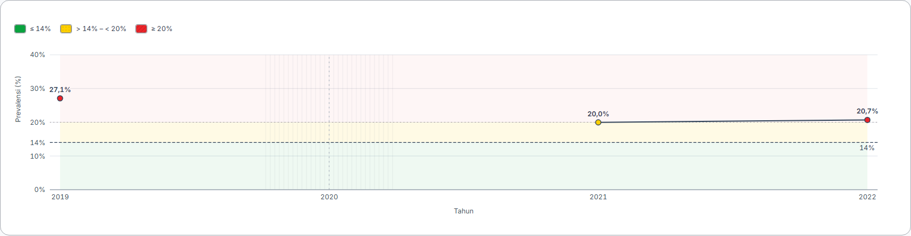
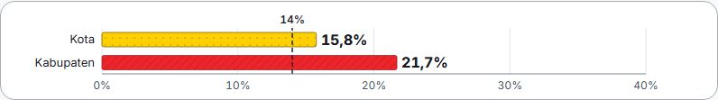

# Instrumen Uji Dashboard Prioritas Intervensi Stunting Jawa Tengah

**Validasi visualisasi Munzner Nested Model Level 3 (Visual Encoding & Idiom) dan Level 4 (Task-Based Usability, ISO 9241-11)**
Kelompok 14 · Visualisasi Data · Departemen Informatika, Universitas Diponegoro · 2026

| Komponen | Isi |
| --- | --- |
| Objek uji | 1 dashboard terpadu dengan 3 komponen diagram: Choropleth Map (“Peta Prevalensi Stunting”), Line Trend (“Analisis Tren Temporal”), Horizontal Bar (“Rata-rata Prevalensi: Kota vs Kabupaten”) |
| Alat uji | Formulir web `/uji/` pada situs dashboard (satu sesi: profil → persetujuan → Level 3 → Level 4 → SUS) |
| Partisipan | N = 20 mahasiswa S1 Informatika: 10 dengan peran Persona A (Operator Internal), 10 dengan peran Persona B (Warga Publik) |
| Data | Terkirim otomatis ke Google Sheet (lembar Responden, L3, L4, SUS, Persetujuan, Analisis) |

## A. Persona (peran)

Persona adalah **peran** yang diberikan penguji kepada responden, bukan karakteristik responden. Kalimat peran berikut tampil di layar profil, pengantar Level 3, dan pengantar Level 4.

| Persona | Kalimat peran | Fokus uji |
| --- | --- | --- |
| **A · Operator Internal** (n = 10) | “Anda berperan sebagai staf teknis Dinas Kesehatan yang memakai dashboard ini untuk pemantauan rutin dan pengambilan keputusan taktis.” | Analisis diagnostik dan cross-filtering |
| **B · Warga Publik** (n = 10) | “Anda berperan sebagai warga yang membuka dashboard ini untuk mencari informasi sendiri tentang kondisi daerah.” | Pencarian informasi mandiri dan pemahaman cepat |

Kalimat peran sengaja netral: tidak menyebut prioritas, wilayah tertinggi, tren atau perubahan, maupun perbandingan kota dan kabupaten, agar tidak membocorkan opsi CBQ pada Level 3.

**Kriteria responden**

- Mahasiswa S1 Informatika.
- Bukan anggota Kelompok 14.
- Setiap orang hanya ikut satu kali (satu peran, satu sesi).

Data profil yang dicatat: nama (tidak dilaporkan), usia, literasi grafik (1 = hampir tidak pernah membaca grafik … 5 = hampir setiap hari), dan mode sesi.

## B. Prosedur sesi (± 15 menit, tatap muka 1-on-1)

**Persiapan**

- Sesi dilakukan tatap muka, satu penguji dengan satu responden, di laptop dengan lebar jendela peramban ≥ 1100 px, zoom peramban 100%, dan mouse. Formulir menampilkan peringatan bila layar lebih sempit.
- Peran dibagi berselang-seling menurut urutan kedatangan responden: A, B, A, B, dan seterusnya sampai masing-masing 10 orang.
- Penguji selalu memakai tautan dengan peran terkunci: `/uji/?persona=A` atau `/uji/?persona=B`. Responden tidak memilih perannya sendiri.
- Satu sesi pilot dilakukan sebelum pengambilan data. Baris hasil pilot dihapus dan tidak dihitung.

**Jalannya sesi**

1. Penguji membuka tautan sesuai giliran peran, lalu menyerahkan laptop kepada responden.
2. Responden mengisi profil (nama, usia, literasi grafik; peran sudah terisi) dan **Pernyataan Kesediaan Sukarela** (4 butir yang dicentang).
3. **Level 3**: layar pengantar menampilkan kartu peran dan daftar lengkap opsi KPI serta CBQ. Setelah itu 3 diagram tersamar disajikan satu per satu dalam urutan acak (bagian C).
4. **Level 4**: layar pengantar menampilkan kartu peran dan daftar misi. Responden mengerjakan 2 tugas sesuai peran pada dashboard asli yang dimuat di dalam formulir (bagian D).
5. **SUS**: 10 pernyataan skala 1 sampai 5, satu pernyataan per layar, diisi segera setelah tugas selesai.
6. Komentar terbuka, lalu kirim. Penguji memastikan layar menampilkan “hasil terkirim”.
7. Penguji menekan **Cetak / simpan pernyataan (PDF)** dan menyimpan PDF pernyataan sukarela dengan nama file kode responden, misalnya `A-K7PQ.pdf`. Lalu tekan **Responden berikutnya**.

Penguji tidak memberi petunjuk selama Level 3 dan Level 4. Bila responden bertanya, jawab: “Silakan lakukan sesuai pemahaman Anda.”

## C. Tugas 1, Level 3: Visual Reverse-Mapping Test (Blinded Chart Masking)

### Stimulus

Setiap stimulus adalah potongan satu panel dari render dashboard saat ini (tahun 2022, semua kabupaten/kota, grafik tren mode Rata-rata).

| Diagram | Gambar |
| --- | --- |
| **D1** Choropleth Map |  |
| **D2** Line Trend |  |
| **D3** Horizontal Bar |  |

**Definisi anotasi yang disembunyikan.** Teks yang menamai metrik disembunyikan: judul panel, subjudul, nama seri, catatan, tautan antarpanel, dan tombol/kontrol. Teks yang berisi data dipertahankan: label nilai, label wilayah pada peta, label sumbu, legenda kategori (≤ 14%, > 14% sampai < 20%, ≥ 20%), garis acuan 14%, dan inset Kep. Karimunjawa. Ukuran area grafik pada stimulus sama dengan tampilan dashboard asli. Stimulus dibuat ulang dengan `UJI_STIMULI=1 npx playwright test tests/e2e/uji-stimulus.spec.ts`.

### Pengenalan opsi

Sebelum diagram pertama, layar pengantar Level 3 menampilkan daftar lengkap opsi KPI (huruf A sampai C) dan CBQ (angka 1 sampai 3), tanpa diagram, dengan keterangan bahwa opsi ini sama untuk ketiga diagram. Urutan opsi diacak **sekali per responden** saat sesi dibuat, lalu dipakai sama di layar pengantar dan di ketiga diagram. Dengan begitu responden cukup membaca opsi sekali, dan waktu baca per diagram lebih banyak mencerminkan waktu memahami diagram.

### Langkah per diagram

Tekan *Tampilkan diagram* → hitung mundur 3-2-1 → gambar muncul (stopwatch mulai) → pilih KPI → pilih CBQ → *Kunci jawaban* (stopwatch berhenti = **Decode Latency**) → pilih **Confidence** 1 sampai 5 (1 Menebak, 2 Ragu-ragu, 3 Cukup yakin, 4 Yakin, 5 Sangat yakin).

Decode Latency dihitung dari gambar muncul sampai tombol *Kunci jawaban* ditekan.

### Pertanyaan per persona

| Diagram | Pertanyaan Persona A (Operator Internal) | Pertanyaan Persona B (Warga Publik) |
| --- | --- | --- |
| **D1** Choropleth Map | “Berdasarkan pola gradasi warna spasial pada peta ini, indikator pemantauan dan keputusan alokasi intervensi apa yang sedang ditunjukkan?” | “Melihat perbedaan warna antarwilayah pada peta ini, informasi kondisi apa yang paling tepat digambarkan?” |
| **D2** Line Trend | “Berdasarkan pergerakan garis deret waktu ini, evaluasi kinerja antarperiode apa yang harus Anda laporkan?” | “Melihat naik-turunnya garis dari tahun ke tahun pada grafik ini, perubahan kondisi apa yang sedang terjadi?” |
| **D3** Horizontal Bar | “Berdasarkan perbandingan panjang batang horizontal ini, prioritas distribusi intervensi untuk kelompok wilayah mana yang sedang dianalisis?” | “Melihat panjang batang dari atas ke bawah ini, perbandingan apa yang sedang ditampilkan?” |

### Opsi jawaban (sama untuk semua diagram dan persona)

**Pilihan 1: Informasi (KPI) yang ditampilkan**

| Kode | Label | Teks opsi |
| --- | --- | --- |
| KPI-1 | Sebaran wilayah | Tingkat prevalensi stunting tiap kabupaten/kota, dikelompokkan ke dalam kategori risiko |
| KPI-2 | Perubahan antarperiode | Perubahan prevalensi stunting dari periode ke periode (2019, 2021, 2022) |
| KPI-3 | Selisih kelompok | Selisih rata-rata prevalensi stunting antara kelompok kota dan kelompok kabupaten |

**Pilihan 2: Pertanyaan bisnis (CBQ) yang dijawab.** Kategori ini dipakai untuk matriks Fleiss' κ.

| Kode | Label | Teks opsi | Padanan pada lembar tugas | CBQ laporan kelompok |
| --- | --- | --- | --- | --- |
| CBQ-1 | Wilayah risiko tertinggi | Wilayah mana yang prevalensinya paling tinggi dan perlu diprioritaskan untuk intervensi? | Wilayah kepadatan/risiko tertinggi | CBQ 1 · Wilayah prioritas |
| CBQ-2 | Laju perubahan tren | Bagaimana prevalensi berubah dari periode ke periode: membaik atau memburuk? | Laju perubahan tren bulanan | CBQ 2 · Perubahan 2019–2022 |
| CBQ-3 | Peringkat perbandingan kelompok | Kelompok wilayah mana (kota atau kabupaten) yang peringkatnya lebih tinggi dan perlu porsi intervensi lebih besar? | Peringkat alokasi anggaran sektor | CBQ 4 · Kota dan kabupaten |

### Kunci jawaban (Ground Truth), khusus penguji

| Diagram | KPI benar | CBQ benar |
| --- | --- | --- |
| D1 Choropleth Map | KPI-1 | CBQ-1 |
| D2 Line Trend | KPI-2 | CBQ-2 |
| D3 Horizontal Bar | KPI-3 | CBQ-3 |

**E2E benar** = KPI benar **dan** CBQ benar. **Lucky guess** = E2E benar dengan Confidence ≤ 2 (dicatat sebagai anomali).

## D. Tugas 2, Level 4: Task-Based Usability Testing

Dashboard asli dimuat di dalam formulir. Dok di bagian bawah layar selalu menampilkan skenario, stopwatch, dan tombol **Jawab** yang membuka laci jawaban. Stopwatch mulai setelah dashboard selesai dimuat dan berhenti saat task selesai atau responden menekan **Saya menyerah**. Jawaban yang ditolak boleh diperbaiki; setiap penolakan dihitung sebagai jawaban salah.

### Persona A: Operator Internal (analisis diagnostik & cross-filtering)

| Task | Skenario | Isian jawaban | Kunci |
| --- | --- | --- | --- |
| **A1** Identifikasi Anomali Spasial-Temporal | Temukan kabupaten/kota dengan prevalensi stunting tertinggi tahun 2022 pada peta “Peta Prevalensi Stunting”. Klik wilayah tersebut agar grafik “Analisis Tren Temporal” di bagian bawah otomatis mengikuti wilayah itu, lalu tentukan pada periode mana prevalensi wilayah tersebut melonjak (naik). | Wilayah tertinggi 2022; periode lonjakan (2019 → 2021 / 2021 → 2022 / Tidak ada kenaikan) | Kab. Brebes (29,1%); 2021 → 2022 (26,3% → 29,1%) |
| **A2** Perbandingan Lintas Kelompok | Pada grafik batang “Rata-rata Prevalensi: Kota vs Kabupaten” tahun 2022, bandingkan kelompok kota dan kabupaten. Tentukan kelompok dengan rata-rata prevalensi tertinggi, lalu cari wilayah di kelompok itu yang kinerjanya paling menurun, yaitu kenaikan prevalensi terbesar 2019→2022 (kolom “Perubahan 2019→2022” pada tabel “Peringkat Wilayah”). | Kelompok; rata-rata (%); wilayah | Kabupaten; 21,7%; Kab. Pati (+3,6 pp) |

### Persona B: Warga Publik (pencarian informasi mandiri & pemahaman cepat)

| Task | Skenario | Isian jawaban | Kunci |
| --- | --- | --- | --- |
| **B1** Kondisi Wilayah Tempat Tinggal | Bayangkan Anda tinggal di Kabupaten Temanggung. Cari Kab. Temanggung pada peta “Peta Prevalensi Stunting” dan klik wilayahnya. Lalu periksa pada grafik “Analisis Tren Temporal” apakah kondisi stunting di wilayah tersebut membaik atau memburuk pada periode terakhir (2021 → 2022). | Prevalensi 2022 (%); kondisi (Membaik / Memburuk / Tetap sama) | 28,9%; Memburuk (20,5% → 28,9%) |
| **B2** Transparansi Prioritas | Ubah filter Tahun menjadi 2021. Pada grafik batang “Rata-rata Prevalensi: Kota vs Kabupaten”, temukan kelompok wilayah dengan rata-rata prevalensi paling besar. Setelah itu, kembalikan tampilan dashboard ke posisi awal (reset filter). | Kelompok; rata-rata (%) | Kabupaten; 20,1%; dashboard kembali ke Tahun 2022 dan Wilayah “Semua Kab/Kota” |

Wilayah B1 dibuat tetap (Kab. Temanggung) agar tingkat kesulitan sama bagi semua responden. Skenario menyebut panel dengan judul yang tertulis di dashboard.

**Kriteria sukses B2.** Saat responden menekan *Kirim jawaban*, B2 dinyatakan sukses hanya bila semua isian benar **dan** dashboard sudah kembali ke posisi awal: filter Tahun = 2022 dan filter Wilayah = “Semua Kab/Kota”. Yang diperiksa adalah keadaan dashboard, bukan cara mencapainya; tombol Reset Filter maupun mengubah dropdown sama-sama sah. Bila isian benar tetapi dashboard belum kembali, formulir menampilkan pesan netral “Tugas belum selesai. Periksa lagi langkah di skenario.”, menambah hitungan jawaban salah, dan task belum selesai. Pesan ini tidak menyebut tombol atau ikon apa pun. Bila isian salah, pesannya sama dengan task lain.

Jawaban angka diterima dengan koma atau titik (21,7 atau 21.7) dan harus sama dengan nilai satu desimal yang ditampilkan dashboard.

### Data yang direkam otomatis per task

| Data | Definisi |
| --- | --- |
| Sukses | 1 bila task selesai tanpa bantuan (semua isian benar, dan untuk B2 dashboard sudah kembali ke posisi awal); 0 bila menyerah |
| Time-on-task | Detik sejak dashboard siap hingga task selesai/menyerah |
| Jawaban salah | Jumlah pengiriman jawaban yang ditolak (isian salah, atau pada B2 isian benar tetapi dashboard belum kembali) |
| Klik tanpa respons | Klik pada area dashboard yang bukan kontrol interaktif (indikator salah klik/kebingungan navigasi) |
| Error | Jawaban salah + klik tanpa respons |
| Perubahan filter | Jumlah perubahan dropdown/kotak centang |
| Cross-filter dipakai | A1 (Brebes) dan B1 (Temanggung): wilayah sasaran pernah terpilih lewat peta, tabel, panel perubahan, atau dropdown Wilayah, sehingga grafik tren mengikutinya. Sumbernya dapat dibaca dari log interaksi. Kosong untuk task lain |
| Reset | B2: 1 bila dashboard berada di posisi awal (Tahun 2022, Wilayah “Semua Kab/Kota”) saat task berakhir, termasuk saat menyerah; 0 bila belum. Kosong untuk task lain |
| Log interaksi | Urutan klik dan perubahan filter dengan cap waktu, untuk analisis kebingungan |

## E. System Usability Scale (SUS)

Skala 1 (sangat tidak setuju) sampai 5 (sangat setuju).

1. Saya berpikir akan sering menggunakan dashboard ini.
2. Saya merasa dashboard ini rumit untuk digunakan.
3. Saya merasa dashboard ini mudah digunakan.
4. Saya membutuhkan bantuan orang teknis untuk dapat menggunakan dashboard ini.
5. Saya merasa fitur-fitur dashboard ini (peta, grafik, tabel, filter) terintegrasi dengan baik.
6. Saya merasa ada banyak hal yang tidak konsisten pada dashboard ini.
7. Saya merasa kebanyakan orang akan cepat memahami cara menggunakan dashboard ini.
8. Saya merasa dashboard ini membingungkan.
9. Saya merasa percaya diri saat menggunakan dashboard ini.
10. Saya perlu banyak belajar sebelum dapat menggunakan dashboard ini.

Skor = [Σ(butir ganjil − 1) + Σ(5 − butir genap)] × 2,5 → 0–100. Grade (Sauro–Lewis): A ≥ 80,3; B ≥ 74; C ≥ 68; D ≥ 51; F < 51.

Pertanyaan terbuka: “Bagian dashboard mana yang paling membingungkan, dan apa saran Anda?”

## F. Pernyataan Kesediaan Sukarela

Saya yang bertanda tangan di bawah ini menyatakan bahwa:

1. Saya mengikuti uji coba dashboard ini secara sukarela, tanpa paksaan dan tanpa imbalan yang mengikat.
2. Saya memahami bahwa yang diuji adalah dashboard, bukan kemampuan saya, dan saya boleh berhenti kapan saja tanpa konsekuensi.
3. Saya mengizinkan jawaban, waktu pengerjaan, dan aktivitas klik saya selama uji direkam dan diolah untuk laporan mata kuliah Visualisasi Data, Departemen Informatika, Universitas Diponegoro.
4. Saya memahami bahwa nama saya tidak akan dicantumkan dalam laporan; hasil disajikan dengan kode responden.

Disetujui secara elektronik dengan mencentang keempat butir pada formulir; waktu persetujuan tercatat di lembar Persetujuan. Setiap responden dapat mencetak lembar pernyataan sebagai PDF di akhir sesi.

## G. Metrik dan target kelulusan

| Level | Metrik | Rumus | Target |
| --- | --- | --- | --- |
| 3 | Acc_E2E | Σ E2E benar ÷ n | ≥ 85% |
| 3 | Decode Latency | Mean ± SD detik sejak gambar tampil hingga jawaban dikunci | ≤ 10 s |
| 3 | Fleiss' κ | Subjek = 3 diagram, penilai = responden, kategori = CBQ-1/2/3. P_i = (Σ n_ij² − n) / (n(n − 1)); P̄ = rata-rata P_i; p_j = Σ n_ij ÷ (N·n); P̄e = Σ p_j²; κ = (P̄ − P̄e) / (1 − P̄e). Dihitung untuk κ_Internal, κ_Publik, κ_Total | ≥ 0,75 |
| 3 | Confidence | Rata-rata skor 1–5; lucky guess = E2E benar dengan skor ≤ 2 | Tanpa target (pelengkap) |
| 3 | Modus / Majority Vote | MAX dan kategori terbanyak per diagram (Total, A, B), dibandingkan dengan kunci | Mayoritas ≥ 85% dan sama dengan kunci |
| 4 | Task Completion Rate | Σ sukses ÷ jumlah task | ≥ 90% |
| 4 | Time-on-Task & Error | Rata-rata detik per task; rata-rata error per task | ≤ 30 s/task |
| 4 | SUS | Skor 0–100 | ≥ 75 (Grade B) |

Komponen diagram dengan mayoritas < 85%, modus meleset dari kunci, P_i terendah, confidence terendah, atau error tertinggi ditetapkan sebagai prioritas perbaikan. Lembar **Analisis** pada Google Sheet menghitung semuanya secara otomatis (bagian F: diagnosis).

## H. Penyesuaian terhadap lembar tugas

| Butir lembar tugas | Penyesuaian | Alasan |
| --- | --- | --- |
| Persona A dan B sebagai kelompok pengguna | Persona diberikan sebagai **peran**; semua responden mahasiswa S1 Informatika | Responden berasal dari satu populasi, sehingga perbedaan persona diwujudkan lewat kalimat peran, pertanyaan, dan task |
| Istilah template: kecamatan, bulanan, sektor/anggaran | Kecamatan menjadi kabupaten/kota; bulanan menjadi antarperiode; sektor/anggaran menjadi kelompok kota vs kabupaten dan porsi intervensi | Data dashboard berupa prevalensi tahunan (2019, 2021, 2022) per kabupaten/kota |
| Diagram 2: grafik tren | Memakai grafik tren satu garis (mode Rata-rata) | Mode Kota vs Kab. akan tumpang tindih dengan makna Diagram 3 (perbandingan kelompok) |
| Anotasi disembunyikan | Label sumbu dan legenda kategori tetap tampil | Keduanya berisi data, bukan nama metrik. Akibatnya Level 3 berpotensi lebih mudah; hal ini dicatat sebagai batasan |
| Opsi jawaban Level 3 | Opsi KPI-1/2/3 ditambahkan di samping CBQ | Agar E2E (KPI benar dan CBQ benar) dapat dihitung |
| B2: “lalu kembalikan tampilan dashboard ke posisi awal (reset filter)” | Dipertahankan dan diperiksa otomatis dari keadaan dashboard | Lihat kriteria sukses B2 di bagian D |
